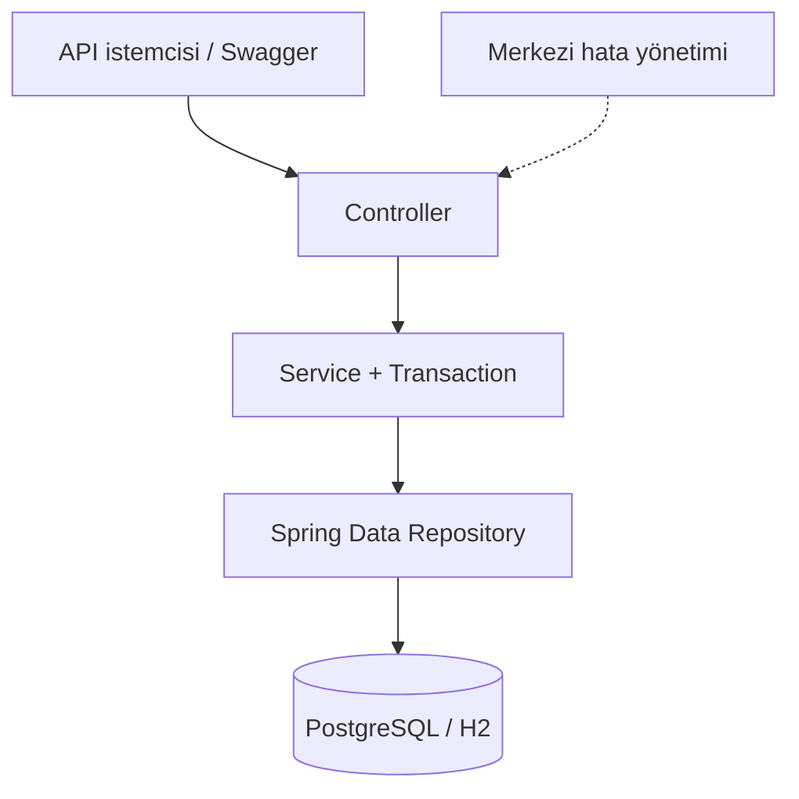

# Kütüphane Yönetim API'si

[](https://github.com/omermuktar/K-t-phaneTakip/actions/workflows/ci.yml)
[](https://openjdk.org/)
[](https://spring.io/projects/spring-boot)
[](LICENSE)

Bu proje, 2022 yılında üzerinde çalıştığım Java Swing/JDBC tabanlı kütüphane takip
uygulamasını 2026 yılında yeniden tasarladığım sürümdür. Masaüstü uygulamasındaki temel kitap ve
üye mantığını koruyarak projeyi Spring Boot tabanlı bir REST API'ye dönüştürdüm; ödünç/iade
kurallarını, testleri ve çalıştırma altyapısını yeniden ele aldım.

## Bu projeyi neden yeniden geliştirdim?

Eski sürüm, doğrudan veritabanına bağlanan bir masaüstü uygulamasıydı. Yeniden geliştirme
sırasında amacım aynı problem alanını güncel backend yaklaşımlarıyla çözmek ve yalnızca CRUD
işlemlerinden oluşmayan bir yapı kurmaktı. Bu nedenle stok tutarlılığı, transaction yönetimi,
eşzamanlı ödünç verme, merkezi hata cevapları, otomatik testler ve farklı veritabanı profilleri
üzerinde özellikle çalıştım.

## Öne çıkan özellikler

- Kitap ve kopya envanteri yönetimi
- Üye oluşturma, güncelleme, arama ve durum yönetimi
- Güvenli ödünç verme ve iade akışları
- Gecikmiş kayıtların dinamik hesaplanması
- Başlık, yazar, ISBN, kategori ve uygunluk filtreleri
- Sayfalama ve sıralama
- Transaction yönetimi ve eşzamanlı işlem kilitleri
- Jakarta Validation ile istek doğrulama
- RFC 9457 uyumlu standart `ProblemDetail` hata cevapları
- Swagger UI / OpenAPI belgelendirmesi
- PostgreSQL + Flyway migration desteği
- H2 ile hızlı yerel çalışma ve integration testleri
- Docker Compose ile tek komutta çalıştırma
- GitHub Actions ile otomatik build, test, kapsam kalite kontrolü ve PostgreSQL container smoke testi

## Teknoloji yığını

| Alan | Teknoloji |
|---|---|
| Dil ve platform | Java 17, Spring Boot 4.1 |
| Web | Spring Web MVC, REST API |
| Veri erişimi | Spring Data JPA, Hibernate |
| Veritabanı | PostgreSQL, H2 |
| Şema yönetimi | Flyway |
| Doğrulama | Jakarta Validation |
| API belgesi | Springdoc OpenAPI, Swagger UI |
| Test | JUnit 5, AssertJ, MockMvc, H2, JaCoCo |
| Build | Maven Wrapper |
| Operasyon | Docker, Docker Compose, Actuator, GitHub Actions |

## Mimari



Kod, özelliğe göre paketlenmiştir:

```text
com.omermuktar.library
├── book          # Kitap modeli, repository, service, controller ve DTO'lar
├── member        # Üye yönetimi
├── loan          # Ödünç/iade ve gecikme kuralları
├── dashboard     # Özet metrikler
├── common        # Sayfalama, persistence ve hata altyapısı
└── config        # Clock, OpenAPI ve geliştirme verisi
```

Projeyi yeniden tasarlarken aldığım teknik kararlar [mimari belgesinde](docs/ARCHITECTURE.md),
çalıştırılabilir örnek istekler ise [HTTP istek dosyasında](docs/http/library-api.http) bulunur.

## Hızlı başlangıç

### Gereksinimler

- Java 17+
- Docker kullanmayacaksanız Maven Wrapper bağımlılıkları indirmek için internet bağlantısı

### H2 ile yerel çalıştırma

Varsayılan `dev` profili, dosya tabanlı H2 veritabanı ve örnek kayıtlarla açılır:

```bash
./mvnw spring-boot:run
```

Uygulama başladıktan sonra:

- Swagger UI: <http://localhost:8080/swagger-ui.html>
- OpenAPI JSON: <http://localhost:8080/v3/api-docs>
- Sağlık kontrolü: <http://localhost:8080/actuator/health>
- H2 Console: <http://localhost:8080/h2-console>

H2 bağlantı adresi:

```text
jdbc:h2:file:./data/librarydb
```

Kullanıcı adı `sa`, parola boştur.

### PostgreSQL ve Docker ile çalıştırma

```bash
docker compose up --build
```

Bu komut PostgreSQL'i hazırlar, Flyway migration'larını uygular ve API'yi `8080` portunda başlatır.

Servisleri durdurmak için:

```bash
docker compose down
```

Veritabanı hacmini de kaldırmak için yalnızca geliştirme ortamında şu komut kullanılabilir:

```bash
docker compose down --volumes
```

## Temel API uçları

| Metot | Uç | Açıklama |
|---|---|---|
| `POST` | `/api/v1/books` | Kitap oluşturur |
| `GET` | `/api/v1/books` | Kitapları arar ve filtreler |
| `PUT` | `/api/v1/books/{id}` | Kitabı günceller |
| `DELETE` | `/api/v1/books/{id}` | Geçmişi olmayan kitabı siler |
| `POST` | `/api/v1/members` | Üye oluşturur |
| `GET` | `/api/v1/members` | Üyeleri arar ve filtreler |
| `PUT` | `/api/v1/members/{id}` | Üyeyi günceller |
| `POST` | `/api/v1/loans` | Kitabı ödünç verir |
| `POST` | `/api/v1/loans/{id}/return` | Kitabı iade alır |
| `GET` | `/api/v1/loans/overdue` | Geciken kayıtları listeler |
| `GET` | `/api/v1/dashboard/summary` | Sistem özetini getirir |

Hazır istek örnekleri [docs/http/library-api.http](docs/http/library-api.http) dosyasındadır.

### Ödünç verme örneği

```http
POST /api/v1/loans
Content-Type: application/json

{
  "bookId": 1,
  "memberId": 1,
  "loanDays": 14
}
```

### Standart hata örneği

```json
{
  "type": "about:blank",
  "title": "İşlem Çakışması",
  "status": 409,
  "detail": "Üyenin bu kitap için zaten aktif bir ödünç kaydı var.",
  "instance": "/api/v1/loans",
  "code": "DUPLICATE_ACTIVE_LOAN",
  "timestamp": "2026-08-10T09:00:00Z"
}
```

## Testler

```bash
./mvnw verify
```

Toplam 31 test; %90,7 satır ve %83,9 dal kapsamıyla çalışır. JaCoCo kalite kapısı satır
kapsamının %90'ın, dal kapsamının %80'in altına düşmesi halinde build'i başarısız yapar.
CI ayrıca Docker Compose ile PostgreSQL ve API container'larını açar; Flyway migration'ından
sonra sağlık ve OpenAPI uçlarını gerçek HTTP istekleriyle kontrol eder.

Test paketi şu senaryoları kapsar:

- Kopya sayısının ödünç/iade sırasında doğru güncellenmesi
- Stokta olmayan kitabın verilememesi
- Aynı üyenin aynı kitabı iki kez aktif olarak alamaması
- Kitap ve üye CRUD, arama, filtreleme ve benzersizlik kuralları
- Aktif/gecikmiş ödünç kayıtları ve dashboard metrikleri
- Ödünç geçmişine bağlı silme ve üye pasifleştirme kuralları
- Transaction içindeki iş kuralları ve stok tutarlılığı
- REST doğrulama, bozuk istekler ve standart hata cevapları
- Spring uygulama bağlamının açılması

## Yapılandırma

Üretim ortamında kullanılan değişkenler `.env.example` içinde listelenmiştir. Gerçek parola veya erişim anahtarları repoya eklenmemelidir.

| Değişken | Açıklama |
|---|---|
| `SPRING_PROFILES_ACTIVE` | Üretimde `prod` |
| `DATABASE_URL` | PostgreSQL JDBC adresi |
| `DATABASE_USERNAME` | Veritabanı kullanıcısı |
| `DATABASE_PASSWORD` | Veritabanı parolası |
| `DATABASE_POOL_SIZE` | Bağlantı havuzu büyüklüğü |
| `SERVER_PORT` | HTTP portu; varsayılan `8080` |

## Projenin geçmişi ve atıf

Deponun [8 Ocak 2022 tarihli commit'i](https://github.com/omermuktar/K-t-phaneTakip/tree/84d0b623e85087ae395a8ccb73dac611b8084c63),
üzerinde çalıştığım Java Swing/JDBC tabanlı ilk sürümü korur. Bu sürüm, Akshat Agarwal'ın MIT
lisanslı [Library-Management](https://github.com/git-akshat/Library-Management) projesinin Türkçe
arayüz uyarlamasını temel alır; kaynak projeye ait atıf ve lisans bilgileri tarihsel sürümde
korunmuştur. Ayrıntılı lisans bildirimi [üçüncü taraf bildirimleri](THIRD_PARTY_NOTICES.md)
dosyasındadır.

Eski ZIP; sabit yerel veritabanı parolası ve güncel olmayan JDBC sürücüleri içerdiğinden modern dalın güncel dosyalarından kaldırılmıştır. Tarihsel commit değişmeden korunur.

2026 yılında eski çalışmayı backend odaklı yeniden tasarladım. Güncel sürümün REST API'si, veri
modeli, iş kuralları, transaction sınırları, doğrulama, hata yönetimi, testleri, Docker ve CI/CD
altyapısı bu modernizasyon kapsamında oluşturuldu.

## Lisans

2026 yılında yeniden geliştirdiğim Spring Boot sürümü [MIT Lisansı](LICENSE) ile sunulur.
